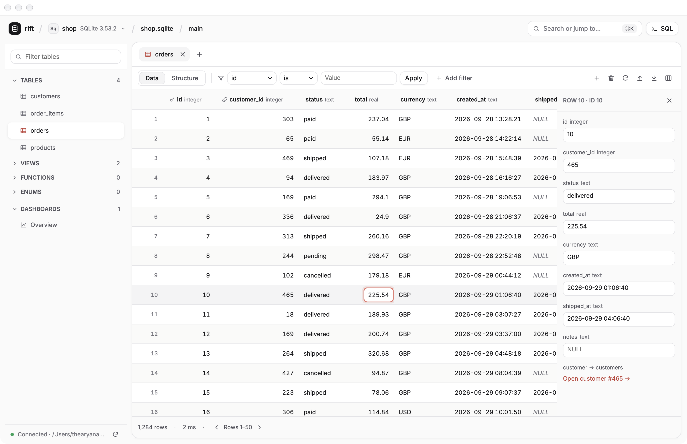
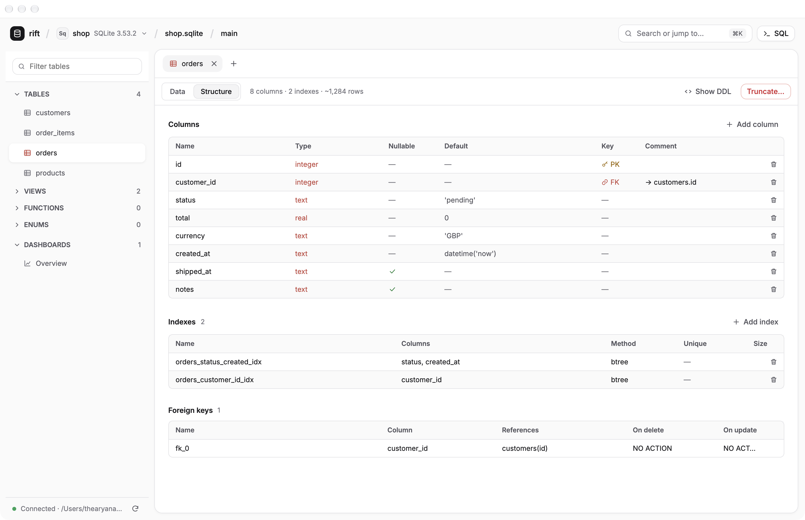
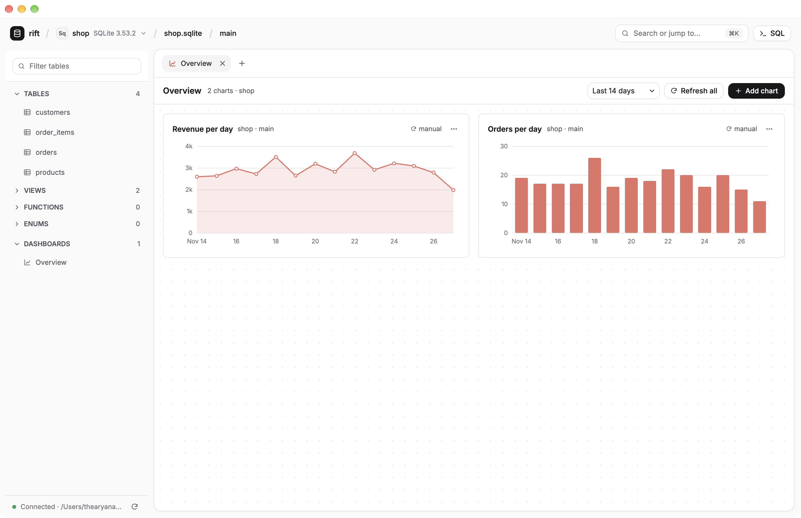
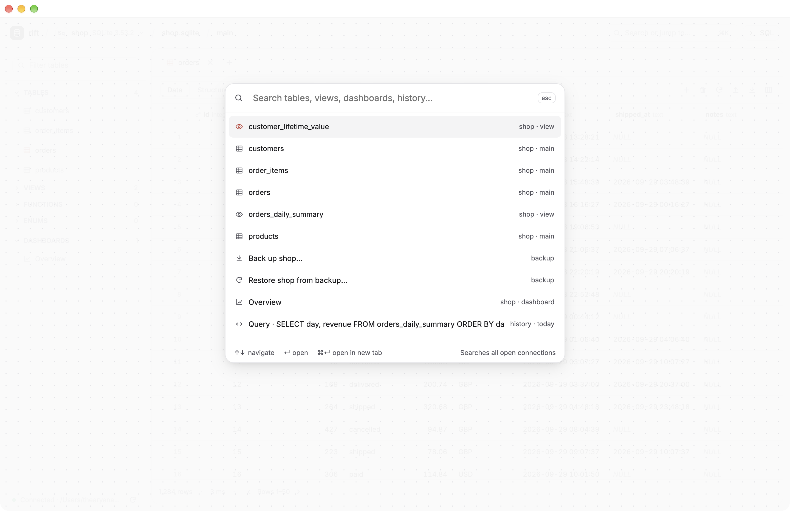

# Rift

A fast, native database client for PostgreSQL, MySQL, SQLite, ClickHouse, Redis and FoundationDB.
Written in Rust on [GPUI](https://www.gpui.rs/). Runs on macOS, Linux and Windows.



## Features

- **Data grid**: browse, filter, sort and page through tables. Edit cells inline; changes are
  staged and saved together in one transaction. A row panel follows foreign keys.
- **Structure**: columns, indexes and foreign keys. Add or drop columns and indexes, see the DDL.
- **SQL editor**: syntax highlighting, autocomplete, run the current statement or the whole
  script, explain, format, query history.
- **Charts and dashboards**: chart any result (line, bar, area, scatter) and pin it to a
  dashboard.
- **Command palette** (⌘K): jump to any table, view, dashboard or past query across open
  connections.
- **Redis** key browser with TTLs, and a **FoundationDB** key/value view.
- **Safe mode**: mark a connection read-only so writes are refused.
- SSH tunnels, TLS, passwords kept in the OS keychain.

| Structure | Dashboard | Command palette |
|---|---|---|
|  |  |  |

## Install

Prebuilt binaries are attached to each [GitHub release](https://github.com/projectlighthouse-io/rift/releases)
(shell, PowerShell and Homebrew installers).

## Build from source

Needs Rust 1.98 (pinned in `rust-toolchain.toml`; rustup picks it up).

```sh
cargo run -p rift            # debug
cargo build --release -p rift
```

On Linux, install GPUI's headers first:

```sh
sudo apt install libxkbcommon-dev libxkbcommon-x11-dev libwayland-dev libx11-xcb-dev \
  libxcb1-dev libvulkan-dev libfontconfig-dev libfreetype-dev libasound2-dev libssl-dev pkg-config
```

FoundationDB support loads `libfdb_c` at runtime, so Rift builds without it. Install the
FoundationDB client to use it, or point `RIFT_FDB_LIB` at the library.

## Try it with SQLite

No Docker needed. Create the demo shop database and add it as a SQLite connection:

```sh
sqlite3 shop.sqlite < dev/seed/sqlite.sql
cargo run -p rift
```

The screenshots above use this database.

## Local databases (Docker)

To try every engine, `docker-compose.yml` runs PostgreSQL, MySQL, ClickHouse, Redis and
FoundationDB with seed data:

```sh
make dev-up      # start and wait until healthy
make dev-seed    # load seed data (re-runnable)
make dev-down    # stop and delete data
```

## Project layout

| Crate | Role |
|---|---|
| `crates/app` | The `rift` binary: GPUI UI |
| `crates/types` | Shared value, table and chart types |
| `crates/traits` | Capability traits drivers implement (`Query`, `Browse`, `EditRows`, …) |
| `crates/dialect` | SQL generation per engine (edits, DDL, quoting) |
| `crates/drivers/*` | One crate per engine |
| `crates/registry` | The only place the app reaches drivers |
| `crates/conn` | Connection wrappers (read-only mode, SSH) |
| `crates/store` | App data: saved connections, history, dashboards (SQLite) |
| `crates/fdb-ffi` | FoundationDB client bindings |

`scripts/check-deps.sh` enforces the layering. Design notes are in
[`docs/DECISIONS.md`](docs/DECISIONS.md) and code style in [`docs/STYLE.md`](docs/STYLE.md).
Changes are tracked in [`CHANGELOG.md`](CHANGELOG.md).

## License

MIT OR Apache-2.0.
